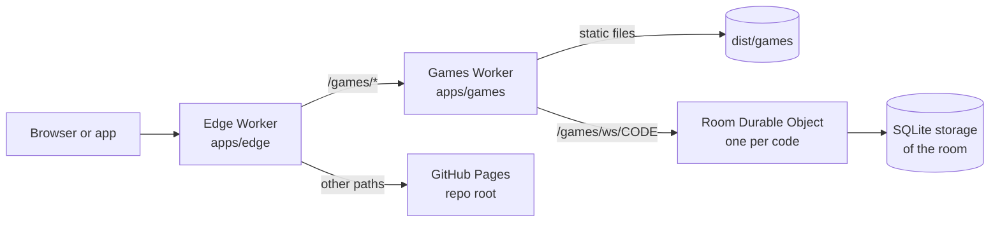
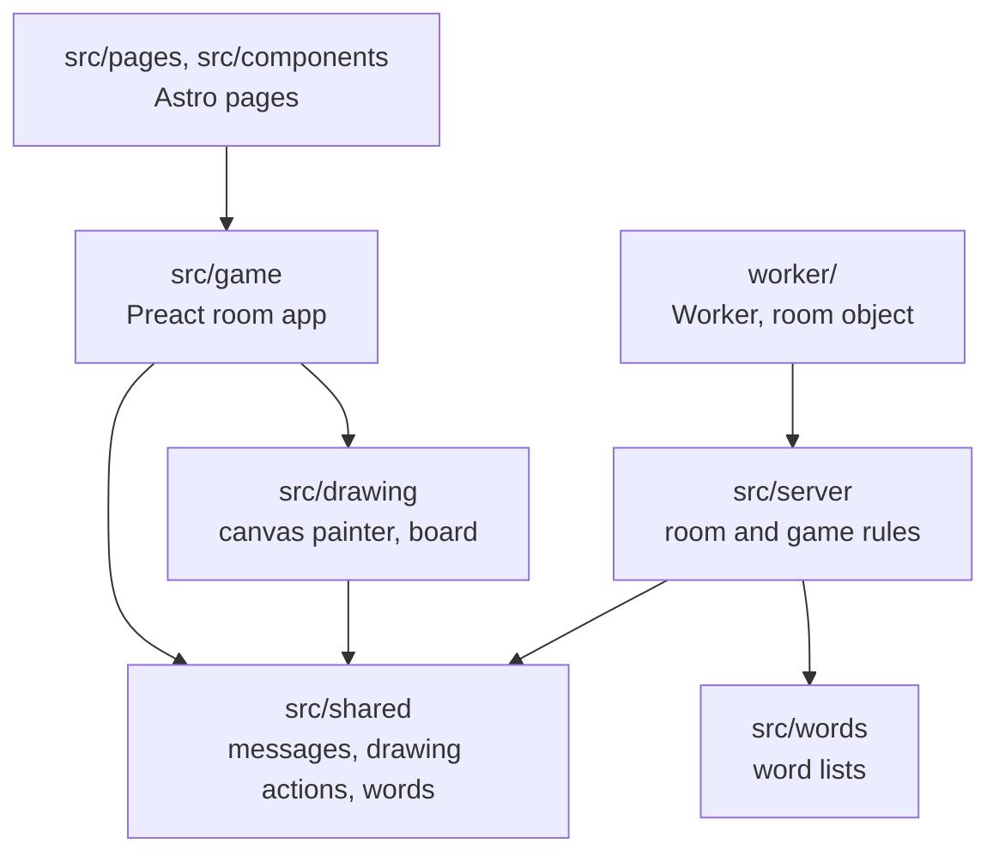
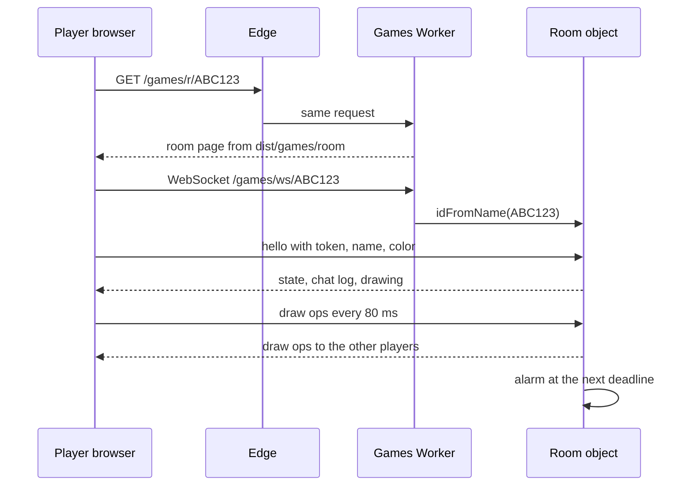

# Architecture

## Shape

Micro frontends split by top path. Each app in `apps/` builds and deploys alone, and the edge Worker on workbenchsoft.com sends each path to its owner. No page mixes two apps, so the apps share no runtime code.

## Layers of the games app

- **`src/shared`** imports nothing from the other folders. The browser and the Worker both run it.
- **`src/server`** has no Cloudflare code, so Vitest runs the rules with a fake clock and a fake socket layer.
- **`worker/`** is the only place that touches Durable Objects, storage and alarms.

## How a room works

- **Identity** the browser keeps a random token. The room hashes it into the player id, so the token stays secret from the other players.
- **Hibernation** the room accepts sockets through the Hibernation API. An idle room leaves memory, and a socket message or an alarm wakes it from storage.
- **Timers** alarms drive every deadline: picking a word, the end of a turn, a telephone step, a clue round, and the cleanup 30 minutes after the room empties.

## Data

| Key in the room's storage | What it holds | When it is written |
| --- | --- | --- |
| `meta` | Players, scores, host, settings, phase, chat log, game state | After each event that changes it |
| `canvas` | The drawing of the current turn | At most every 2 seconds |
| `chain:N` | The entries of telephone story N | Once per entry |

## Shared page state

| Resource | Owner | Guard |
| --- | --- | --- |
| Web storage | `src/game/storage.ts`, keys start with `wg-` | Other code calls `load` and `save` |
| `<html lang>` | `src/game/i18n.ts` | `setLang` writes it |
| URL paths | `src/site/routes.ts` and `src/shared/paths.ts` | Pages and the Worker read `ROUTES` and `BASE` |

## Decisions

| Decision | Options weighed | Picked | Why | Cost to undo |
| --- | --- | --- | --- | --- |
| Room server | Durable Objects, Supabase Realtime, PartyKit, a VPS | Durable Objects with hibernation | Free plan, one object per room, no server to run | High: the room code is written for it |
| Split of the domain | One app, micro frontends by path | Micro frontends by path | The public site and the games build and deploy apart | Medium: the edge is small |
| Pages | Astro static, a Preact SPA, Next.js | Astro static plus a Preact island | Search engines get full HTML, the pages ship almost no JS | Medium |
| Drawing sync | Send pixels, send actions | Send actions on an 800 by 600 grid | Small messages, undo, and late joiners get the full picture | Medium |
| Mobile apps | Capacitor, a TWA, React Native | Capacitor | The same pages on Android and iOS, with the AdMob plugin | Low |
