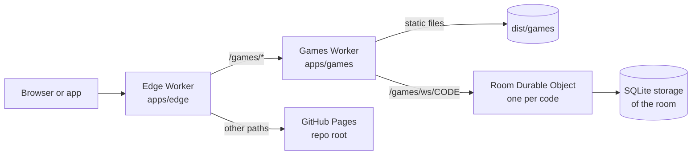
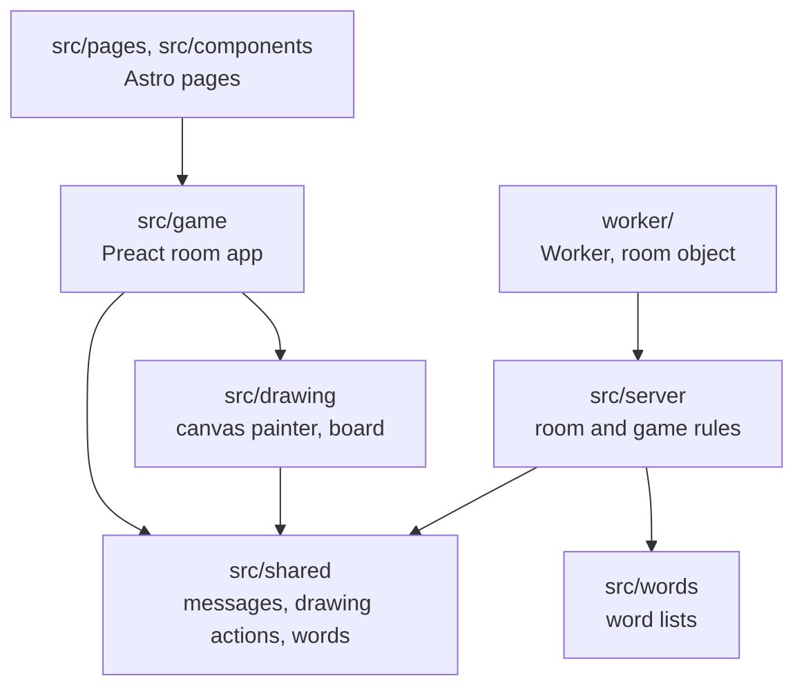

# Architecture

## Shape

Micro frontends split by top path. Each app in `apps/` builds and deploys alone, and the edge Worker on workbenchsoft.com sends each path to its owner. No page mixes two apps, so the apps share no runtime code.

## Layers of the games app

- **`src/shared`** imports nothing from the other folders. The browser and the Worker both run it.
- **`src/server`** has no Cloudflare code, so Vitest runs the rules with a fake clock and a fake socket layer.
- **`worker/`** is the only place that touches Durable Objects, storage and alarms.

## How a room works

- **Identity** the browser keeps a random token. The room hashes it into the player id, so the token stays secret from the other players.
- **Protocol version** `hello` carries `PROTOCOL` from `src/shared/protocol.ts`, and the room keeps it with the socket. The apps ship their own copy of the client, so a change an old client can't read raises the number, and the Worker answers each socket in its own format.
- **Hibernation** the room accepts sockets through the Hibernation API. An idle room leaves memory, and a socket message or an alarm wakes it from storage.
- **Timers** alarms drive every deadline: picking a word, the end of a turn, a telephone step, a clue round, and the cleanup 30 minutes after the room empties.

## Data

| Key in the room's storage | What it holds                                                | When it is written               |
| ------------------------- | ------------------------------------------------------------ | -------------------------------- |
| `meta`                    | Players, scores, host, settings, phase, chat log, game state | After each event that changes it |
| `canvas`                  | The drawing of the current turn                              | At most every 2 seconds          |
| `chain:N`                 | The entries of telephone story N                             | Once per entry                   |

## Shared page state

| Resource      | Owner                                          | Guard                                         |
| ------------- | ---------------------------------------------- | --------------------------------------------- |
| Web storage   | `src/game/storage.ts`, keys start with `wg-`   | Other code calls `load` and `save`            |
| `<html lang>` | `src/game/i18n.ts`                             | `setLang` writes it                           |
| URL paths     | `src/site/routes.ts` and `src/shared/paths.ts` | Pages and the Worker read `ROUTES` and `BASE` |

## Decisions

Each choice below names what the games picked, what it costs and what lost. The most expensive to undo comes first.

### Room server: Durable Objects with hibernation

- **Picked** one Durable Object per room code, through the Hibernation API. Alarms drive the timers, and the room's SQLite storage keeps its state.
- **Why** the owner wants no hosting bill. Workers Free covers the rooms, one object maps to one room, and there is no server to run. With hibernation 20 WebSocket messages count as 1 request.
- **Trade-off** Workers Free gives 100,000 requests a day, about 40 hours of drawing a day. The room code is written for Durable Objects.
- **Rejected**
  - **Supabase Realtime** no source records why it lost beyond the points above. It relays messages, and the game rules and timers would still need a server.
  - **PartyKit** no source records why it lost. It adds a layer over the same Durable Objects.
  - **A VPS** a server to pay for, patch and keep up.
- **Cost to undo** high. `worker/room-object.ts`, the storage keys and the alarms are written for it.

### Domain split: micro frontends by path

- **Picked** the edge Worker in `apps/edge` sends `/games/*` to the games Worker, and every other path to GitHub Pages.
- **Why** the public site and the games build and deploy apart. No page mixes two apps, so they share no runtime code.
- **Trade-off** each app keeps its own packages, checks and workflow, so a shared tool bump happens once per app.
- **Rejected**
  - **One app for the domain** the public site and the games would ship in one build.
- **Cost to undo** medium. The edge is small, but each app's base path and deploy follow it.

### Pages: Astro static pages with a Preact island

- **Picked** Astro builds the landing, game and info pages into `dist/games/`. Preact runs the room app on `/games/room/`.
- **Why** search engines get full HTML, and the pages ship almost no JS. Only the "Create a room" button runs a script.
- **Trade-off** the room app and the pages are 2 kinds of code: Astro components and Preact components.
- **Rejected**
  - **A Preact single page app** search engines would get an empty page to index.
  - **Next.js** more JS on each page and a server build, for pages that are static.
- **Cost to undo** medium. Each page and the room app's mount point would move.

### Drawing sync: actions on a fixed grid

- **Picked** `src/shared/canvas.ts` keeps a drawing as a list of actions on an 800 by 600 grid. The server and every browser apply the same actions.
- **Why** the messages stay small, undo is one step back in the list, and a late joiner gets the full picture from the list.
- **Trade-off** the server stores the list, at most every 2 seconds, and each painter must give the same result from it.
- **Rejected**
  - **Send pixels** each update would be large, with no undo and no way to rebuild the picture for a late joiner.
- **Cost to undo** medium. The painter, the room storage and the telephone stories use the action list.

### Game rules: plain classes outside the Worker

- **Picked** `src/server` holds the room and the three games with no Cloudflare code. `worker/` is the only folder that touches Durable Objects, storage and alarms.
- **Why** Vitest runs the rules with a fake clock and a fake socket layer.
- **Trade-off** the room object has to pass each event and timer into the rules, and save what they change.
- **Rejected**
  - **Rules inside the Durable Object** each test would need the Workers runtime and real timers.
- **Cost to undo** low. The boundary sits in `room-object.ts`.

### Mobile apps: Capacitor

- **Picked** Capacitor wraps `dist/` for Android and iOS. The apps load the pages from local files and open the sockets on workbenchsoft.com.
- **Why** the same pages run on Android and iOS, with the AdMob plugin for the banner.
- **Trade-off** an iOS build needs a Mac or a cloud Mac and the paid Apple developer account. The apps ship their own copy of the client, so the socket format carries a `PROTOCOL` version.
- **Rejected**
  - **A Trusted Web Activity** Android only, and it can't place a native AdMob banner.
  - **React Native** the pages would be written again as native screens.
- **Cost to undo** low. `capacitor.config.ts`, `admob.ts` and the native projects hold it.
