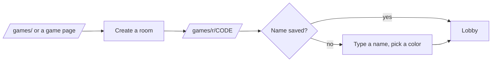
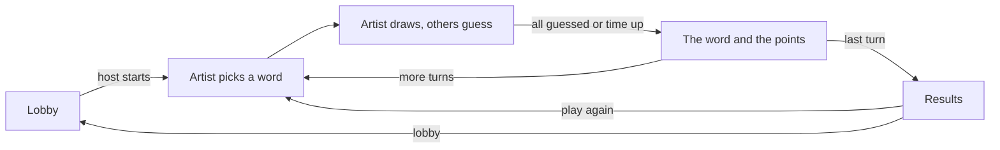
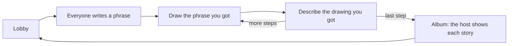
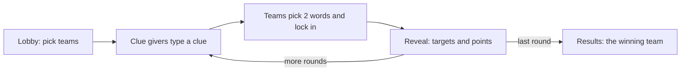

# User flows

## Start a room

1. The person opens `/games/`, `/games/ru/` or a game page.
2. They press "Create a room". The page makes a 6 letter code and opens `/games/r/CODE`.
3. The first visit asks for a name and a color. Later visits go straight in.
4. The lobby shows the invite link with Copy and Share buttons.

## Join by link or code

1. A friend opens the link from a chat. Or they type the code on `/games/` under "Have a room code?".
2. They type a name and land in the lobby. The host sees them in the player list.

## Guess the drawing

1. The host picks "Guess the drawing", the rounds and the drawing time, then presses Start.
2. The artist sees 3 words and picks one within 15 seconds.
3. The artist draws with the pen, the eraser and the fill. The others type guesses in the chat.
4. A right guess earns points and hides the word from the chat. A near guess shows "close" to its writer.
5. The turn ends when everyone guessed or the time ran out. The word and the points show for 6 seconds.
6. After the last round the results list the players by score.

## Drawing telephone

1. Everyone writes a phrase, or takes one from "Give me an idea".
2. Each step hands the last entry to the next player. They draw a phrase or describe a drawing.
3. When the time runs out, the page sends what the player has so far.
4. The album shows each story one step at a time when the host presses Next.

## Clue duel

1. Players join the red or the blue team in the lobby. The host can shuffle them.
2. Each clue giver sees 2 marked words on the board and types a one word clue.
3. Both clues show to everyone. Each team picks 2 words and locks them in.
4. The reveal colors each team's words and shows the round's points.

## In the Android and iOS apps

1. The app opens on the games home page from its own files.
2. Creating a room opens the room page inside the app. The invite link points at games.workbench-soft.com, so friends without the app join in the browser.
3. An AdMob banner shows in the lobby and on the results, and hides during play.
