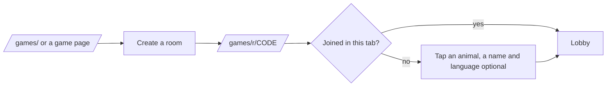
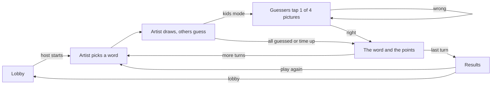
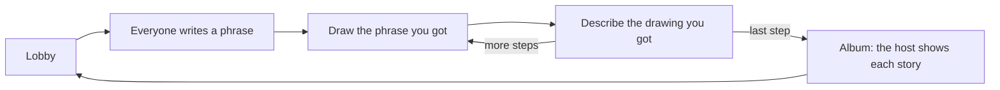
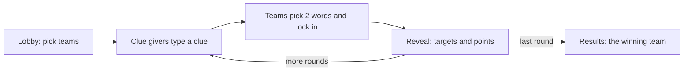

# User flows

## Start a room

1. The person opens `/games/`, `/games/ru/` or a game page.
2. They press "Create a room". The page makes a 6 letter code and opens `/games/r/CODE`.
3. Each new tab shows 12 animals with the saved one picked, a name field and a language picker, the host included. A tap on an animal or Join joins. A reload in the same tab goes straight in.
4. The lobby shows the invite link with Copy and Share buttons. The room code in the header copies it in every phase. Change on the own row opens the join screen again.

## Join by link or code

1. A friend opens the link from a chat. Or they type the code on `/games/` under "Have a room code?".
2. They tap an animal and land in the lobby. The host sees them in the player list.

## Guess the drawing

1. The host picks "Guess the drawing" and presses Play. "For little ones" is on unless the host clears it.
2. The artist sees 3 words, each with a picture and a speaker button, and picks one within 15 seconds, or 30 in kids mode.
3. The artist draws with the pen, the eraser and the fill. In kids mode the page reads the word aloud and the guessers tap one of 4 pictures. A wrong picture greys out. The chat takes typed guesses in both modes.
4. A right guess plays a chime and confetti for the guesser.
5. A right guess earns points and hides the word from the chat. A near guess shows "close" to its writer.
6. The turn ends when everyone guessed or the time ran out. The word and the points, or stars in kids mode, show for 6 seconds.
7. After the last round the results list the players by score.

## Drawing telephone

1. Everyone writes a phrase, or takes one from "Give me an idea".
2. Each step hands the last entry to the next player. They draw a phrase or describe a drawing.
3. When the time runs out, the page sends what the player has so far.
4. The album shows each story one step at a time when the host presses Next.

## Clue duel

1. Players join the red or the blue team in the lobby. The host can shuffle them.
2. Each clue giver sees 2 marked words on the board and types a one word clue.
3. Both clues show to everyone. Each team picks 2 words and locks them in.
4. The reveal colors each team's words and shows the round's points.

## In the Android and iOS apps

1. The app opens on the games home page from its own files.
2. Creating a room opens the room page inside the app. The invite link points at games.workbench-soft.com, so friends without the app join in the browser.
3. An AdMob banner shows in the lobby and on the results, and hides during play.
