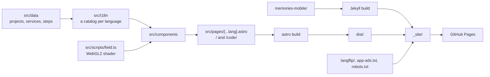
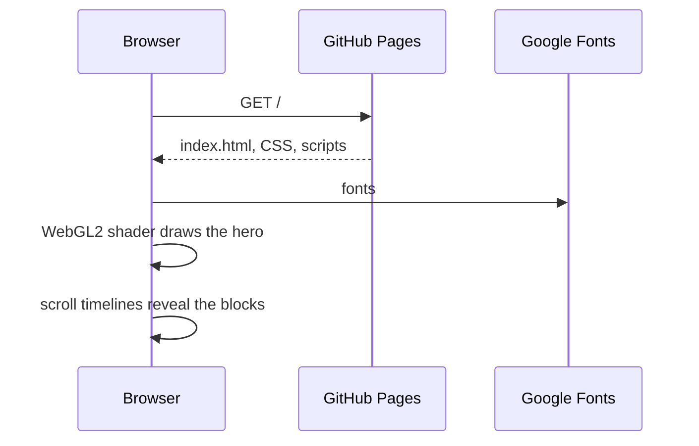
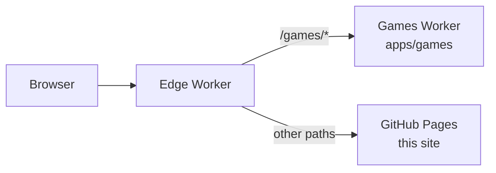

# Architecture

The repo serves <https://workbench-soft.com> from GitHub Pages. The site has no server and no outside service at run time, apart from Google Fonts.

## Parts

| Part          | Folder                      | Built by            |
| ------------- | --------------------------- | ------------------- |
| Home page     | `src/`                      | Astro, into `dist/` |
| Memories site | `memories-mobile/`          | Jekyll              |
| Langflip page | `langflip/`                 | copied as is        |
| Root files    | `app-ads.txt`, `robots.txt` | copied as is        |

## Home page

- **Data** `src/data/projects.ts` holds each project with its features in groups. `src/data/studio.ts` holds the services, the process steps, the stack and the email. Both hold the English text.
- **Languages** Astro's i18n routing builds `src/pages/[...lang].astro` once per language: English at `/`, the others at `/<code>/`. Each component reads `Astro.currentLocale` and takes its text from `src/i18n/`.
  - **Catalogs** `en.ts` holds the English UI text. `ru.ts`, `de.ts` and the others hold the UI text plus the services, steps and projects, matched by project id and feature order.
  - **Helpers** `src/i18n/index.ts` merges a catalog into the data: `projectsIn`, `servicesIn`, `stepsIn` and `ui`.
  - **Test** `catalogs.test.ts` compares each catalog with English: keys, list lengths, `{placeholders}` and empty strings.
  - **SEO** `Base.astro` writes `<html lang>`, `hreflang` alternates and `og:locale`. `@astrojs/sitemap` writes `sitemap-index.xml` with the same alternates.
- **Components** one Astro file per block: `Nav`, `Hero`, `Marquee`, `Services`, `Projects` with `ProjectPanel`, `Process`, `Contact` and `Palette`.
- **Scripts** each component bundles its own TypeScript. `field.ts` draws the hero terrain. The palette builds its index from the rendered panels, so it finds what the page shows.
- **Styles** `src/styles/global.css` holds the colours, buttons and the reveal. Each component keeps its own scoped styles.
- **Counts** the hero counts come from the data at build time, so the HTML holds them before any script runs.

## A visit

## Deploy

1. A push to `main` starts [pages.yml](../.github/workflows/pages.yml).
2. mise installs node and pnpm from `mise.toml`, then pnpm installs the packages.
3. `mise run lint`, `mise run test` and `mise run check` check the code, then `mise run build` writes `dist/`.
4. Jekyll builds the Memories site into `_site/memories-mobile`.
5. The job copies `dist/`, `langflip/` and the root files into `_site/` and publishes it.

A pull request runs steps 2 to 4 and the copy, then stops before the publish.

## Domain

- **Name** `workbench-soft.com`, bought at Cloudflare Registrar. Its DNS sits on Cloudflare.
- **Records** the apex holds the 4 GitHub Pages `A` and `AAAA` addresses, and `www` is a `CNAME` to `workbench-soft.github.io`. Both are DNS only, so GitHub issues the certificate.
- **Pages setting** the repo's Pages settings hold the custom domain with Enforce HTTPS on. `pages.yml` deploys an artifact, so a `CNAME` file would do nothing.
- **Redirects** GitHub sends `www` and each `workbench-soft.github.io/<path>` to the same path on `https://workbench-soft.com` with a 301.

## workbenchsoft.com and the apps

The domain sits behind the edge Worker in [apps/edge](../apps/edge/). [registry.json](../registry.json) lists which app owns each top path, and every other path comes from this site on GitHub Pages.

- **Apart** each app in `apps/` has its own packages, checks and deploy in the [Games workflow](../.github/workflows/games.yml). This site's build leaves `apps/` out.
- **Games** [apps/games/docs/architecture.md](../apps/games/docs/architecture.md) describes the rooms and the games.

## Decisions

Each choice below names what the repo picked, what it costs and what lost. The most expensive to undo comes first. The games keep their own decisions in [apps/games/docs/architecture.md](../apps/games/docs/architecture.md#decisions).

### App releases: in this public repo

- **Picked** each app's CI publishes its APKs and installers on this repo's releases page. The tag starts with the repo name, such as `tickalot-v2025.10.28.3`.
- **Why** the code repos are private. The apps installed from an APK read the release list through the GitHub API, which needs no token for a public repo.
- **Trade-off** each app repo needs the `RELEASES_TOKEN` secret, a fine-grained token with write access here. The releases of every app share one list.
- **Rejected**
  - **Releases in each private repo** a visitor couldn't download them, and each updater would need a token.
- **Cost to undo** high. Each app's release job and in-app updater point at this repo.

### Hosting: GitHub Pages

- **Picked** `pages.yml` publishes `_site/` to <https://workbench-soft.com>.
- **Why** the org stack puts a static site on GitHub Pages. The repo is public, so Pages costs nothing, and the site needs no server.
- **Trade-off** Pages runs no code and sends no custom headers. The games on workbenchsoft.com need a Worker in front, see below.
- **Rejected**
  - **Cloudflare Workers static assets** the org host for apps with a backend. No source records why the site stayed off it. Pages needs no account token in CI.
- **Cost to undo** medium. The deploy job, the domain and the links in each app's Play listing would move.

### Domain: workbench-soft.com with DNS only records

- **Picked** the apex points at GitHub Pages through grey cloud records on Cloudflare DNS.
- **Why** the Google Play payments profile and the store listings want the studio's own domain. GitHub Pages issues the certificate and does the `www` and `github.io` redirects at no cost.
- **Trade-off** Cloudflare caches nothing and adds no headers, since the proxy is off. An `app-ads.txt` crawler may refuse the cross domain redirect from `github.io`, so each Play listing has to name the new domain.
- **Rejected**
  - **Cloudflare proxy on** GitHub can't issue or renew its certificate behind the proxy, and the SSL mode would need care to avoid a redirect loop.
  - **Stay on workbench-soft.github.io** a `github.io` name reads as a hobby page on a payments profile.
- **Cost to undo** low. Removing the domain in the Pages settings brings back `workbench-soft.github.io`.

### workbenchsoft.com: an edge Worker in front of Pages

- **Picked** the Worker in `apps/edge` reads `registry.json` and sends each top path to the app that owns it. Every other path comes from GitHub Pages.
- **Why** the games need a Worker and Durable Objects, while the public site stays on Pages. Each app in `apps/` builds and deploys apart.
- **Trade-off** the domain's DNS has to sit on Cloudflare, and each request to workbenchsoft.com passes through one more Worker.
- **Rejected**
  - **One app for the whole domain** the public site and the games would share one build and one deploy.
  - **Move the whole site to Cloudflare** no source records why it lost. The site then leaves the free Pages host it already has.
- **Cost to undo** medium. `registry.json` and the edge Worker are small, but the domain setup moves with them.

### Home page: Astro static pages

- **Picked** Astro 7 and TypeScript build the home page into static HTML in `dist/`, with small scripts per component.
- **Why** the org stack builds a static site with Astro. Search engines read the text without the scripts, and the hero counts sit in the HTML before any script runs.
- **Trade-off** the repo holds 2 site builders, since the Memories site stays on Jekyll.
- **Rejected**
  - **One hand-written `index.html`** the first version, a plain list of links. The portfolio page needed data, components and 9 languages.
  - **A React app that renders in the browser** search engines and visitors without scripts would see an empty page.
- **Cost to undo** medium. Each component and the i18n routing would move.

### Languages: Astro i18n routing with typed catalogs

- **Picked** Astro's built-in i18n routing with `prefixDefaultLocale: false`. `src/pages/[...lang].astro` builds all 9 languages from `src/i18n/<code>.ts`.
- **Why** each Workbench Soft app ships in 9 languages, and the studio page should reach the same people. A page per language gets its own `hreflang` alternate in the sitemap.
- **Trade-off** each new string goes into 9 catalogs. A Vitest test checks they hold the same keys and counts.
- **Rejected**
  - **i18next with react-i18next** the org pick for TypeScript apps. No source records why it lost. The page has no React, and Astro writes a static page per language with no library in the browser.
  - **One URL that switches language in the browser** search engines would index one language only.
- **Cost to undo** medium. Every component reads its text from the catalogs.

### Memories site: Jekyll as before

- **Picked** `memories-mobile/` keeps its Jekyll build, and `pages.yml` copies the Astro output beside it.
- **Why** the Memories pages came first and work as they are. GitHub Pages builds Jekyll on its own.
- **Trade-off** CI runs Ruby for Jekyll next to Node for Astro.
- **Rejected**
  - **Port the Memories pages to Astro** no source records why it waits. The move gives the visitor the same pages.
- **Cost to undo** low. The Memories site is one folder with its own `_config.yml`.

### Page content: typed data modules

- **Picked** `src/data/projects.ts` and `src/data/studio.ts` hold each project, service and step. The components and the search palette read them.
- **Why** the hero counts, the project panels and the search index all come from one source at build time.
- **Trade-off** a text edit is a code change and a deploy.
- **Rejected**
  - **A headless CMS** the site calls no outside service at run time, apart from Google Fonts.
- **Cost to undo** low. The data sits in 2 files.
