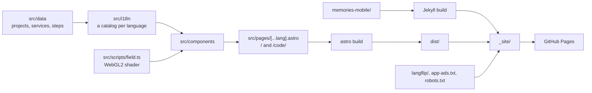
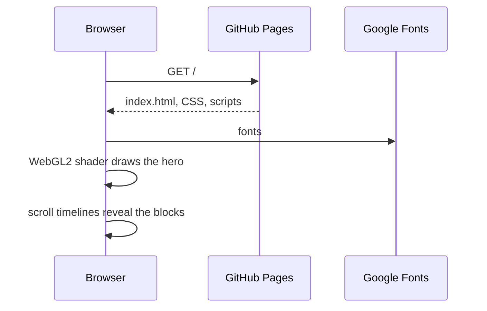
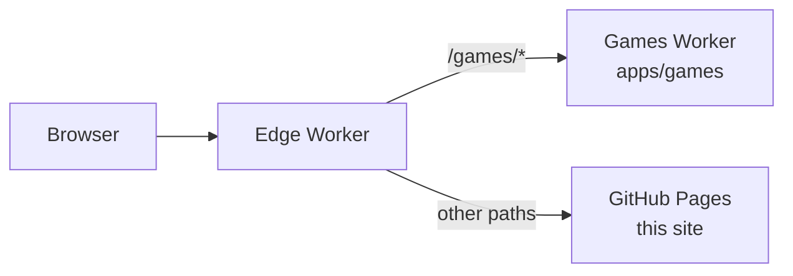

# Architecture

The repo serves https://workbench-soft.github.io from GitHub Pages. The site has no server and no outside service at run time, apart from Google Fonts.

## Parts

| Part          | Folder                      | Built by            |
| ------------- | --------------------------- | ------------------- |
| Home page     | `src/`                      | Astro, into `dist/` |
| Memories site | `memories-mobile/`          | Jekyll              |
| Langflip page | `langflip/`                 | copied as is        |
| Root files    | `app-ads.txt`, `robots.txt` | copied as is        |

## Home page

- **Data** `src/data/projects.ts` holds each project with its features in groups. `src/data/studio.ts` holds the services, the process steps, the stack and the email. Both hold the English text.
- **Languages** Astro's i18n routing builds `src/pages/[...lang].astro` once per language: English at `/`, the others at `/<code>/`. Each component reads `Astro.currentLocale` and takes its text from `src/i18n/`.
  - **Catalogs** `en.ts` holds the English UI text. `ru.ts`, `de.ts` and the others hold the UI text plus the services, steps and projects, matched by project id and feature order.
  - **Helpers** `src/i18n/index.ts` merges a catalog into the data: `projectsIn`, `servicesIn`, `stepsIn` and `ui`.
  - **Test** `catalogs.test.ts` compares each catalog with English: keys, list lengths, `{placeholders}` and empty strings.
  - **SEO** `Base.astro` writes `<html lang>`, `hreflang` alternates and `og:locale`. `@astrojs/sitemap` writes `sitemap-index.xml` with the same alternates.
- **Components** one Astro file per block: `Nav`, `Hero`, `Marquee`, `Services`, `Projects` with `ProjectPanel`, `Process`, `Contact` and `Palette`.
- **Scripts** each component bundles its own TypeScript. `field.ts` draws the hero terrain. The palette builds its index from the rendered panels, so it finds what the page shows.
- **Styles** `src/styles/global.css` holds the colours, buttons and the reveal. Each component keeps its own scoped styles.
- **Counts** the hero counts come from the data at build time, so the HTML holds them before any script runs.

## A visit

## Deploy

1. A push to `main` starts [pages.yml](../.github/workflows/pages.yml).
2. mise installs node and pnpm from `mise.toml`, then pnpm installs the packages.
3. `mise run lint`, `mise run test` and `mise run check` check the code, then `mise run build` writes `dist/`.
4. Jekyll builds the Memories site into `_site/memories-mobile`.
5. The job copies `dist/`, `langflip/` and the root files into `_site/` and publishes it.

A pull request runs steps 2 to 4 and the copy, then stops before the publish.

## workbenchsoft.com and the apps

The domain sits behind the edge Worker in [apps/edge](../apps/edge/). [registry.json](../registry.json) lists which app owns each top path, and every other path comes from this site on GitHub Pages.

- **Apart** each app in `apps/` has its own packages, checks and deploy in the [Games workflow](../.github/workflows/games.yml). This site's build leaves `apps/` out.
- **Games** [apps/games/docs/architecture.md](../apps/games/docs/architecture.md) describes the rooms and the games.
