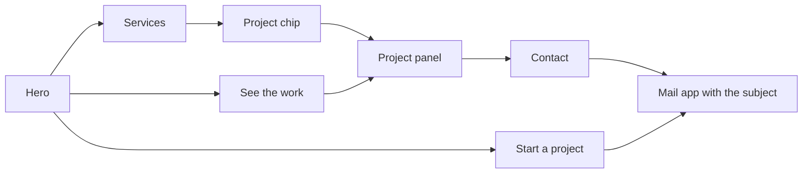
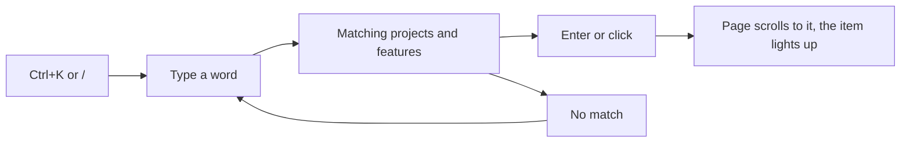
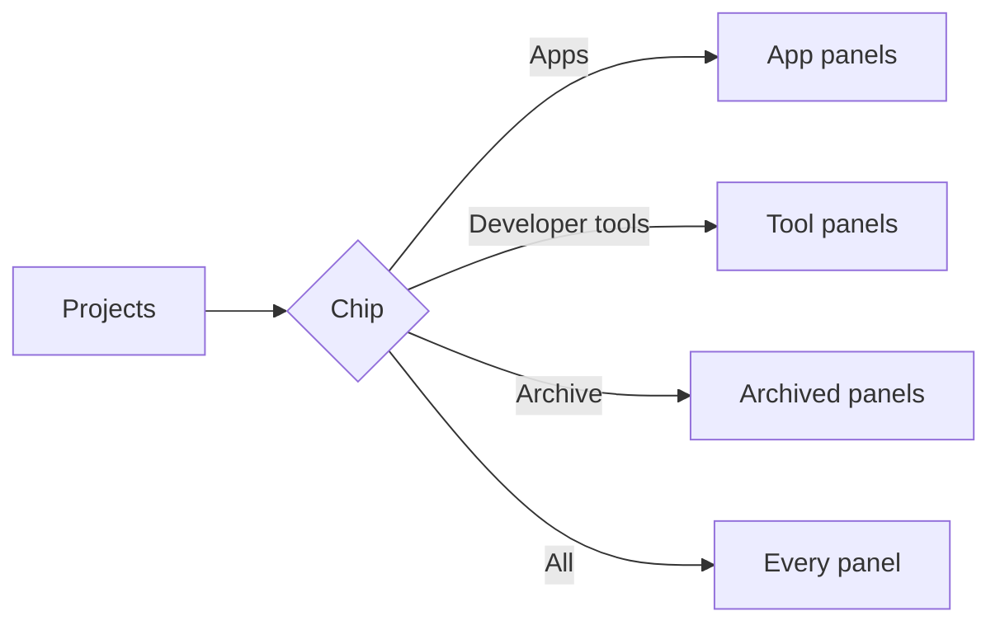

# User flows

## A client looks for a studio

1. The client opens https://workbench-soft.github.io and reads the hero.
2. The client opens Services and picks the kind of work they need.
3. A project chip on the card jumps to a project that shows that work.
4. The client reads the features, then presses Start a project or Write an email.
5. The mail app opens with the subject filled in.

## A visitor finds a feature

1. The visitor presses `Ctrl+K` or `/`.
2. The visitor types a word, such as "voice".
3. The list shows the projects and features that hold the word.
4. Enter or a click closes the search and scrolls to the item, which lights up.

## A visitor filters the projects

1. The visitor opens Projects.
2. A chip picks Apps, Developer tools or Archive.
3. The index and the panels keep only that kind. All brings the rest back.

