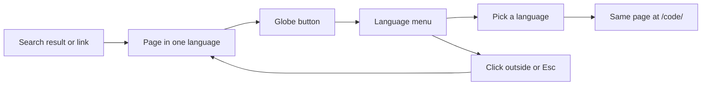
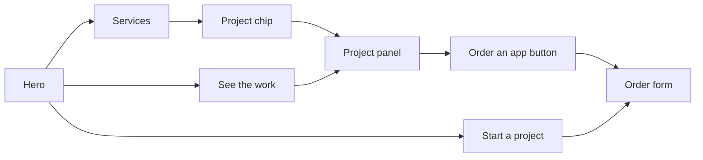
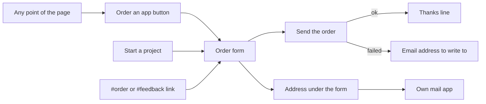
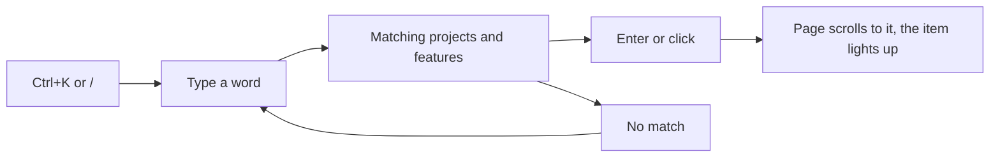
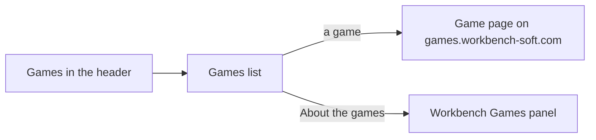
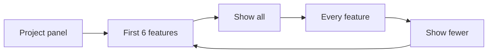
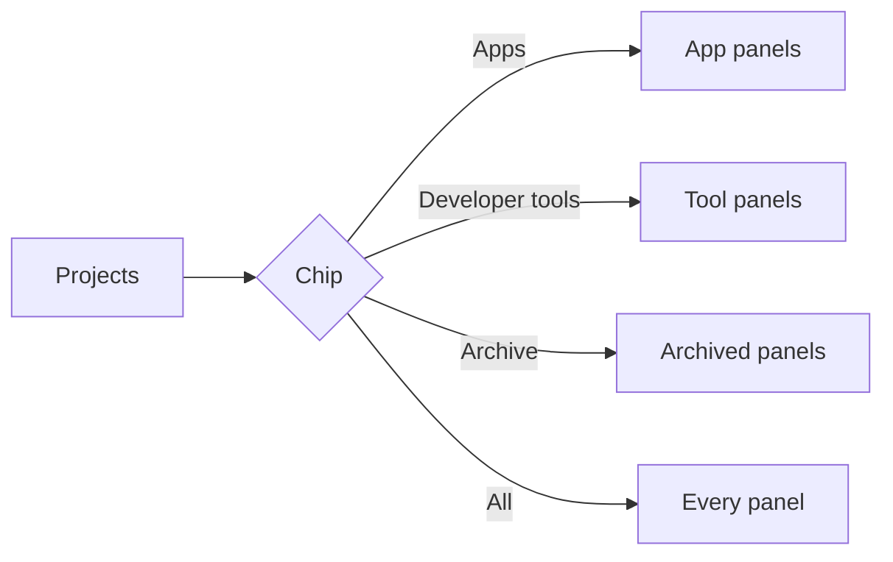
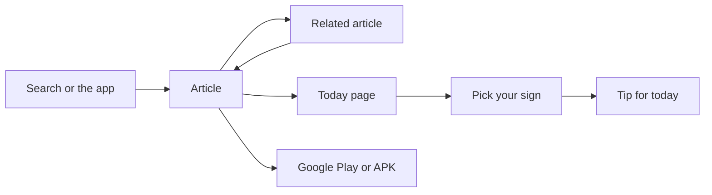

# User flows

## A visitor reads the page in their language

1. A search result or a link opens the page in one of the 9 languages.
2. The visitor presses the globe button in the header.
3. The menu lists each language in its own name, such as Deutsch or 日本語.
4. A pick opens the same page in that language, at `/` for English or `/<code>/` for the rest.

## A client looks for a studio

1. The client opens <https://workbench-soft.com> and reads the hero.
2. The client opens Services and picks the kind of work they need.
3. A project chip on the card jumps to a project that shows that work.
4. The client reads the features, then presses Start a project or Order an app in the corner.
5. The page scrolls to the order form at the bottom.

## A client sends an order

1. The client presses Order an app in the corner, Start a project, Contact, or opens a `#order` link.
2. The page scrolls to the form at the bottom with the cursor in the message box. The corner button hides.
3. The client says what to build, gives an email for the reply and, if they want, a name.
4. Send the order, or `Ctrl+Enter`, posts it from the site. A line says it reached the studio, or gives the email address on a failure.
5. A client who prefers their own mail app presses the address under the form, or Copy.

## A visitor finds a feature

1. The visitor presses `Ctrl+K` or `/`.
2. The visitor types a word, such as "voice".
3. The list shows the projects and features that hold the word.
4. Enter or a click closes the search and scrolls to the item, which lights up.

## A visitor opens a game

1. The visitor presses Games in the header.
2. The list shows all games, each game, and About the games.
3. A game opens on games.workbench-soft.com. About the games scrolls to the Workbench Games panel.

## A visitor reads more features

1. A project shows its first 6 features, one line each.
2. Show all opens the rest. Show fewer folds them again.

## A visitor filters the projects

1. The visitor opens Projects.
2. A chip picks Apps, Developer tools or Archive.
3. The index and the panels keep only that kind. All brings the rest back.

## A reader looks up their sign

1. A search result or the Sky Altar app opens an article, such as `/skyaltar/astrology/signs/leo/`.
2. The reader reads it and follows a related article or the compatibility page.
3. The Today page shows today's Sun and Moon signs and a tip for the reader's sign.
4. The app card leads to Google Play or the APK.

