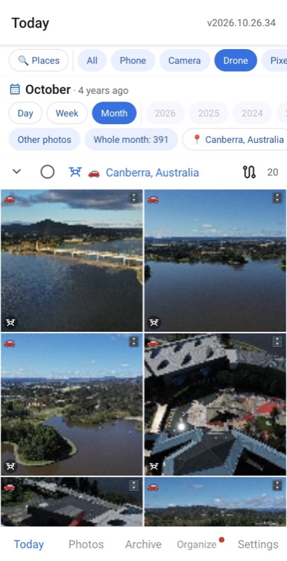
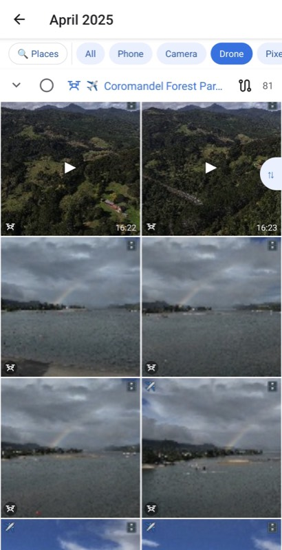
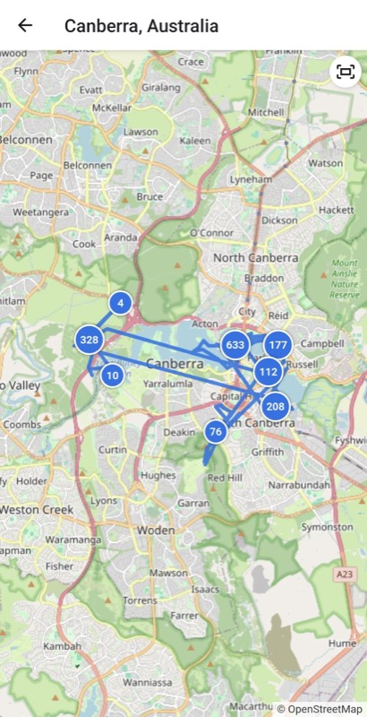
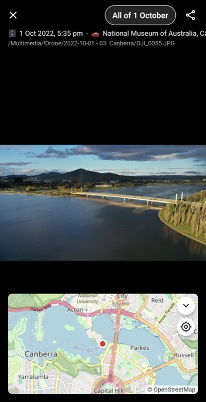
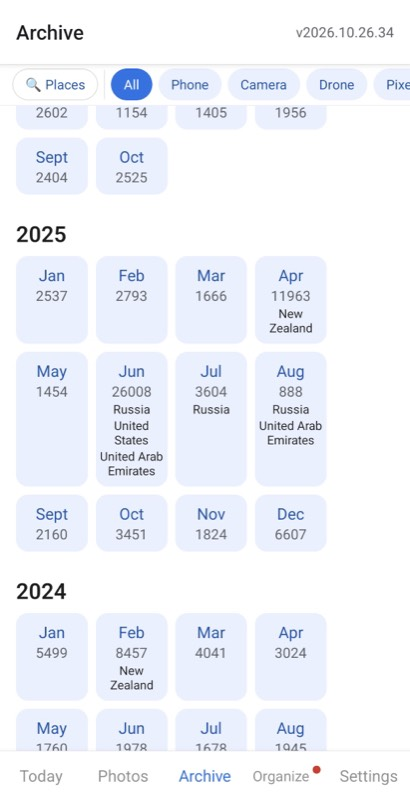
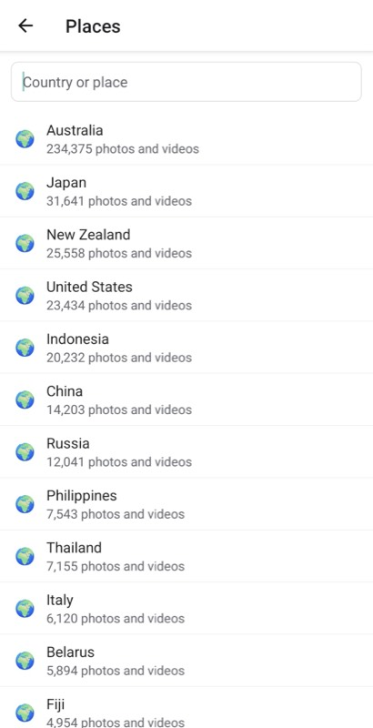

# Memories: on this day photos from your NAS

Memories is an Android app that shows what happened on this day in earlier years. It reads the photos and videos straight from your QNAP or Synology NAS. It works like Google Photos memories, and your photos stay at home.

**[Download the APK]({{ site.download_url }})** · [Privacy policy](privacy-policy)

  
  
  
  
  
  

## What it does

- **Daily reminder** at the time you pick, such as "3 years ago in Japan".
- **Today** shows the photos of this day in each earlier year, split by place.
- **Trips** open every photo of a trip abroad with its route on a map.
- **Archive** opens any year and month, with the countries you visited.
- **Phone backup** uploads the camera folder to dated NAS folders, then frees up the phone.
- **NAS sorting** moves stray photos into the folder of their date and place.

## Guides

- **[On this day photos from your NAS](guides/on-this-day-photos-from-nas)** what the app shows each day and how it picks the year.
- **[WebDAV on QNAP](guides/qnap-webdav)** and **[WebDAV on Synology](guides/synology-webdav)** the NAS setup.
- **[Android photos to the NAS](guides/android-photos-to-nas)** the backup into dated folders.
- **[NAS photos away from home](guides/nas-photos-away-from-home)** Tailscale on the NAS and the phone.

## Your photos stay home

- **No cloud** the phone reads the NAS over WebDAV. No server sits in between.
- **No account** the app sends no data to the developer. Ads come from Google AdMob, see the [privacy policy](privacy-policy).
- **Offline places** a GPS point turns into "Kyoto, Japan" from a database inside the app. No photo location leaves the phone.

## Questions

### Which NAS does it work with?

Any NAS or home server that serves WebDAV, such as QNAP, Synology or TrueNAS. The guides show how to turn WebDAV on for [QNAP](guides/qnap-webdav) and [Synology](guides/synology-webdav).

### Can I see my photos away from home?

Yes. The app reaches the NAS through Tailscale or a remote address. With Tailscale the NAS stays closed to the internet. See [NAS photos away from home](guides/nas-photos-away-from-home).

### How does it handle a big photo library?

The phone reads only the first bytes of each file to get its date and GPS point. A library of tens of thousands of photos indexes on the phone in the background. An optional indexer in a container on the NAS does it faster.

### Is there an iPhone version?

No. Memories runs on Android phones only.

### What does it cost?

It is free. You can support it through [GitHub Sponsors](https://github.com/sponsors/oleg-chibikov).

